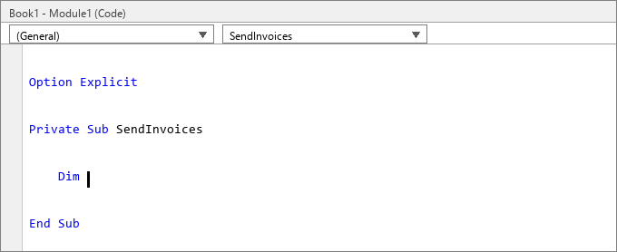

# VbeComplete

[](LICENSE)

**IntelliJ IDEA–style autocomplete for the VBA editor.**



*English · [简体中文](README.zh-CN.md)*

The VBE only completes `object.member` — never *your own* variable or procedure names. This fills
that gap: type a few letters, a live-filtered list appears next to the caret, `Tab` accepts it.
Works in the VBE shared by **Microsoft Office** (Excel, Word, PowerPoint, Access, Visio) and
**WPS Office** — the host is detected automatically.

## Before you start

1. **Windows** plus any host above.
2. **Python 3.8+** (3.10 – 3.12 recommended); tick *Add python.exe to PATH* when installing.
3. **"Trust access to the VBA project object model" must be ticked**, then restart the host —
   *File → Options → Trust Center → Trust Center Settings → Macro Settings*. This is separate from
   the macro security level, and without it the tool can read no code. (WPS Office has the same
   switch under its own options.)
4. Changed the code? **`stop.bat` → overwrite → `run.bat`** — Python loads the `.py` files at startup.

## Usage

```bat
git clone https://github.com/CoffeeBean001/VbeComplete-V587.git
cd VbeComplete-V587
run.bat
```

The first launch installs the dependencies (needs internet), then it runs silently in the
background. `stop.bat` stops it · `install_autostart.bat` / `uninstall_autostart.bat` add / remove
autostart on login · `run_tests.bat` runs the offline regression suite.

| Key | Action |
| --- | --- |
| letter / digit / `_` | Open the list and filter it live |
| `↑` / `↓` | Move the selection (wraps) |
| `Shift+↑` / `Shift+↓` | Close the list and move the caret one line |
| `Tab` | **Accept** the highlighted candidate (the only accept key) |
| click a candidate | Accept with the mouse |
| `Esc` / `←` / `→` / click elsewhere | Dismiss the list |
| `Ctrl+Space` | Force the list to open |
| `Enter` *(at end of line)* | New line with smart indentation, plus an automatic block closer |
| `Shift+Enter` | Start a new line below, leaving the current one intact |
| `Backspace` | Delete a whitespace-only line, or both halves of an empty pair |
| `Ctrl+↑` | Jump to the blank line below the last `Dim` of the procedure (inserting one if needed) |
| `Ctrl+↓` | Jump to the blank line above `End Sub` / `End Function` (inserting one if needed); when the caret lands at column 1 a Tab is pressed for you, so it drops straight at the procedure's indent level |

On accept a `Sub` gets a trailing space, a `Function` gets `()` with the caret inside **and the
VBE's own parameter info pops up** (so you can see the signature while filling in the arguments),
and a keyword gets a space. Typing `(` / `"` auto-closes the pair (caret in the middle, never inside
a comment); with a Chinese IME in full-width / Chinese-punctuation mode the Chinese pair `（）` / `“”`
is inserted instead of being converted to ASCII. Suggested: your variables, constants and
procedures, plus modules, forms
and control names, keywords and built-in functions / types (≈260) — enums (`vb*` / `xl*` / `mso*`)
are excluded. While you *declare* a new name (`Dim …`, `Sub …`) the list stays closed, exactly like
IDEA; after `As` / `New` it still offers types.

**No popup?** Check note 3 first — that is it nine times out of ten. Then look for `pythonw.exe` in
Task Manager; if a list won't close, run `stop.bat` then `run.bat`.

## More

[Feature details & IDEA comparison](docs/features.md) ·
[Troubleshooting 排错](docs/troubleshooting.zh-CN.md) ·
[Chinese docs](docs/features.zh-CN.md) · [MIT License](LICENSE)
